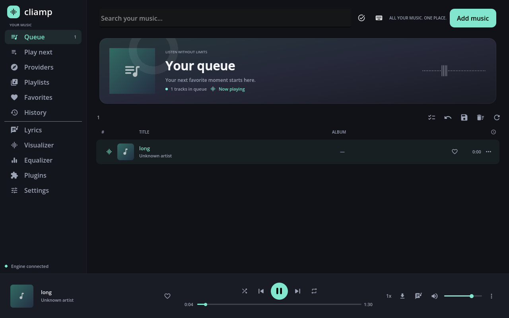

# Desktop app

Cliamp Desktop is a Godot 4 frontend for the existing Go player, with builds for
Linux, Windows, and macOS. The Go engine keeps audio decoding, providers,
playlists, history, EQ, plugins, and remote control in one place. The terminal
player remains available. See [feature parity](desktop-feature-parity.md) for
implemented workflows and remaining platform/account acceptance checks.



*Windows build playing a generated local tone.*

The app follows Godot's [guidance for non-game applications](https://docs.godotengine.org/en/stable/tutorials/ui/creating_applications.html):
the Compatibility renderer, low-processor mode (frames are drawn only when
something changes), dummy audio and physics drivers (the Go engine plays the
audio), native dialog windows, a saved window position and size in `user://window.ini`,
a manual interface-scale setting, and an embedded PCK in exported builds.

## Prerequisites

Use Godot 4.7.2 and Go 1.26.6 (`mise.toml`). Native builds must run on their
target operating system; a Linux build does not validate Windows or macOS.

| Platform | Build and runtime prerequisites |
| --- | --- |
| Linux | ALSA, FLAC, Vorbis, Ogg, and mpg123 development files for the engine; Godot export templates |
| macOS | Xcode command-line tools, Homebrew `flac libvorbis libogg mpg123 pkg-config`; Godot export templates |
| Windows | MSYS2 MinGW64 GCC, pkg-config, FLAC, Vorbis, Ogg, and mpg123 with the MinGW64 `bin` directory on PATH when building and running; Godot export templates |

The [source build instructions](../README.md#building-from-source) list the
codec packages. FFmpeg and yt-dlp remain optional, with the same format and
provider requirements as the terminal app. They must be on the desktop process's
PATH when those features are used.

## Develop

Build the engine from the repository root and open the project:

```sh
go build -o cliamp .
godot --path godot          # run the app
godot --path godot --editor # edit it
```

Set `CLIAMP_BINARY` to the absolute path of the built engine when it is not
beside the app. In PowerShell, set `$env:CLIAMP_BINARY` to the path of `cliamp.exe`.

The app attaches to a running cliamp instance using the same configuration
folder. If none is running, it starts its own headless engine with
`--no-startup-channels`, so the queue starts empty. A plain `cliamp --daemon`
still queues the built-in radio channels. Closing the app
stops only an engine it started. Existing players keep running. Both frontends
share the player's config and library; do not run two independent players
against the same directory when editing settings.

`CLIAMP_CONFIG_DIR` can isolate a test instance. Use **Connect service** in
Providers or Settings to configure a provider with the existing wizard rules.
The form masks credentials and passes them privately to the engine over stdin.
After saving, choose **Restart player** to reload an app-owned engine; the app
asks before stopping playback. For an attached engine, restart it where it was
started. Browser sign-in is available on providers that support it. Provider
setup and credentials remain in the existing cliamp configuration. Never put
credentials in build scripts or project resources.

The client talks to the engine by running `cliamp remote ...`, `cliamp visstream`,
`cliamp preferences ...`, `cliamp setup ...` and `cliamp plugins desktop ...` as
child processes. Godot has no Unix-socket client, so it does not open the IPC
socket itself. On Windows the client escapes quotes in arguments, because Godot
does not.

## Build a development bundle

From the repository root, with `godot` on PATH or `GODOT` set:

```sh
python3 godot/tool/build.py
```

This exports the Godot app with an embedded PCK (the presets are in
`godot/export_presets.cfg`) and places the Go executable beside it. Add
`--debug` for a debug export. `make desktop` invokes the same script. Keep the
whole directory together:

- Linux: `godot/build/linux/` (`Cliamp-Desktop.x86_64` and `cliamp`)
- macOS: `godot/build/macos/Cliamp.app` (the engine is in `Contents/Resources`)
- Windows: `godot/build/windows/` (`Cliamp-Desktop.exe` and `cliamp.exe`)

These are development bundles; macOS bundles are re-signed ad hoc after the
sidecar is staged. The Go sidecar links to the codec libraries
listed above, which must be installed on the target machine. Installers,
redistribution of codec libraries, platform signing, and macOS notarization
are separate release work. `godot/tool/make_icons.py` regenerates the Windows and
macOS icons from `godot/icon/icon.svg`.

## Flatpak

The Linux package is an unofficial build of this fork, with the app id
`io.github.goshitsarch_eng.Cliamp`. It is not published by the cliamp project.
The manifest is `packaging/flatpak/io.github.goshitsarch_eng.Cliamp.yml`.
A built bundle is attached to the `flatpak-0.1.0` GitHub release.

The sandbox opens ALSA through PulseAudio, so audio follows the system default
sink. The package does not include ffmpeg or yt-dlp.

## Validate

From `godot/`, with `GODOT` pointing at the Godot executable:

```sh
$GODOT --headless --import --quit
$GODOT --headless res://tools/check.tscn         # every script and scene loads
$GODOT --headless res://tests/backend_test.tscn  # adapter lifecycle and protocol, fake processes
$GODOT --headless res://tests/dialogs_test.tscn  # native dialogs driven by button presses
$GODOT --headless res://tests/logic_test.tscn
$GODOT --headless res://tests/run_tests.tscn
GODOT_BIN=$GODOT $GODOT --headless -s res://addons/gdUnit4/bin/GdUnitCmdTool.gd --ignoreHeadlessMode -a res://tests/unit  # GdUnit4
CLIAMP_BINARY=/absolute/path/to/cliamp $GODOT --headless res://tests/engine_smoke.tscn
CLIAMP_BINARY=/absolute/path/to/cliamp $GODOT --headless res://tests/engine_dialogs.tscn
PLUGIN_URL=http://127.0.0.1:8765/name.lua CLIAMP_BINARY=/absolute/path/to/cliamp $GODOT --headless res://tests/engine_plugins.tscn
```

`make desktop-test` runs the fake-process suites. The engine smoke starts the
real engine with the current configuration folder: set `CLIAMP_CONFIG_DIR`
and `HOME` to temporary directories first. It generates a WAV file and checks
connection, capabilities, playback, position, spectrum, visualizer frames, seek,
pause, queue edits and revision conflicts, lyrics, preferences, plugins and
provider setup schemas. `engine_dialogs` presses the buttons of the save-to-playlist
chooser, name prompt, playlist tools and provider setup dialogs against the engine.
`engine_plugins` installs a plugin served over local HTTP through the review
dialog (decline, then tick the exact-content approval), lists, configures and
removes it. On Linux CI they use an ALSA null sink. It is not an
audible playback test. The Go tests remain necessary when changing the shared engine.

`godot/tests/screenshots.tscn` opens the shell against a real engine and saves a
PNG of each page; it needs a window, so run it without `--headless`.

## Provider setup protocol

The interactive `cliamp setup` command is unchanged. Desktop clients use:

```sh
cliamp setup schema [--provider KEY]
cliamp setup apply --provider KEY [--save-without-check]
```

Both read a JSON object of string values from stdin, limited to 64 KiB, and
return JSON. They stop reading at the first newline, or at end of input, so a
client that cannot close its pipe can send one line. An unsuccessful request
exits nonzero.
Schema responses describe provider choices, conditional fields, and defaults;
they never return stored or submitted credentials. Apply uses the existing
validation and section writer, preserving unrelated keys/comments. A successful
save returns `restart_required: true`. The explicit `--save-without-check`
option skips the live server probe only; required fields, URLs, environment
references, and provider limits still apply. Never put credentials on the
command line or in the app's resources.

## Library and playback workflows

**Add music** accepts native file/folder selection or entered file, playlist,
URL and SSH paths. Choose append or replace and whether to start playback.
Continue asks for a source when the field is empty. The
engine resolves a selection before replacing the queue, so a failed source leaves
the previous list intact.

The queue and library use fuzzy filtering. **Select tracks** enables individual
or Shift-range selection; **Select visible** selects the current filtered page.
Selected tracks can be appended, queued next, used to replace the queue, saved
or removed in one edit. Live edits carry the revision belonging to the displayed
rows, and a conflict reloads instead of applying a stale row index.

Saved-playlist tools expose supported actions: native **Add files** directly to
the saved list, prepend/append, complete-list sort and reorder, directory sources,
recursive scanning and undo. Adding files resolves the whole selection first
and leaves the live queue unchanged. Directory
tracks remain backed by their source rather than becoming duplicate explicit
rows. Saving the current queue captures the complete engine queue even when the
UI has only loaded a page. After creating, renaming or deleting a playlist,
**Undo last playlist edit** restores that edit from the playlist list when the
provider supports undo. A failed undo remains available to retry.

Provider pages use the service's browse labels and capabilities. This includes
refresh, genres/categories and pinned favorites, related songs, artist links,
subscriptions and newest-episode actions where supported. Radio location remains
unused until an explicit allow/deny choice. Episode markers display the engine's
locally known listening state. **Add to queue** appends an individual track;
**Add collection to queue** resolves the complete collection with its current
filter, including tracks beyond the displayed page, while keeping playback and
the play-next list intact.

**Lyrics** can follow playback, pause following while scrolling, seek by line
and adjust the shared timing offset. Live streams and untimed text are displayed
without an invented playback timebase. **Visualizer** renders the engine's
original built-in and Lua modes, with theme/mode preview, apply/cancel and
fullscreen. Appearance is shared with an attached terminal.

Fullscreen keeps playback controls available: play/pause, previous/next,
five-second seeking, and volume changes of 1 dB. Seeking is disabled for
non-seekable sources. Press **Space** to toggle playback, **,** or **.** to
change track, **Left/Right** to seek, **-/+** to adjust volume, **T** to show or
hide track information, **V** to cycle visualizers and **Esc** to leave
fullscreen. Ctrl/Cmd+Left/Right also changes track.

The command palette lists desktop controls and registered plugin key actions.
Type to filter, press Up or Down to highlight a command, and press Enter to run it.
Volume up and volume down are separate commands. Common shortcuts are:

| Shortcut | Action |
| --- | --- |
| Space | Play/pause |
| Ctrl+Left / Ctrl+Right | Previous/next |
| Alt+Left / Alt+Right | Seek backward/forward |
| Ctrl+Up / Ctrl+Down | Volume up/down |
| Ctrl+O | Add music |
| Ctrl+F | Search |
| Ctrl+J | Jump to an exact playback time |
| Ctrl+Z | Undo queue or saved-playlist edit |
| Ctrl+S | Download playing track |
| Ctrl+K or F1 | Command palette |
| Ctrl+X | Compact player |

Click the current playback time or use **Jump to time** to enter seconds,
`MM:SS`, or `HH:MM:SS`. On macOS, Cmd+J also opens this dialog. The app checks
the track again before seeking so a track change cannot apply the old target
to the next song.

Playback/edit shortcuts do not fire while typing in a text field. Long
operations appear in the activity view, with cancellation when supported.
An operation timeout is not permission to replay a mutation automatically.

## Preferences and plugins

Settings includes searchable grouped preferences for playback, audio quality,
startup, downloads, appearance and provider options. Saving preserves unrelated
config sections. Settings with startup effects require a restart; the app asks
before restarting its own player and does not restart an attached player.
Provider passwords and stored tokens are handled separately by account setup.

The plugin manager can list, install, trust, remove, enable/disable and configure
plugins. Installation and trust are two steps: first review the exact source,
SHA-256 and declared permissions, then approve those exact bytes. Preparing or
canceling a review does not install or trust anything. Plugin configuration values
are submitted privately and never returned by the installed-plugin list.
Runtime commands and registered key actions remain available through the player.

The management commands are also available to other desktop clients:

```sh
cliamp preferences schema
cliamp preferences apply
cliamp plugins desktop list
cliamp plugins desktop prepare
cliamp plugins desktop review
cliamp plugins desktop apply
cliamp plugins desktop trust
cliamp plugins desktop remove
cliamp plugins desktop configure
```

`preferences apply` reads a JSON object of string values on stdin (one line is enough). Its schema
returns only explicitly listed nonsecret fields with types, limits and choices;
invalid or unknown fields reject the change before writing.

Plugin commands read one JSON object on stdin (one line), bounded at 64 KiB. `prepare`
takes `source`; `review` takes the installed `name`. They return a `review` with
`token`, `source`, `sha256`, `permissions`, `code` and implicit-access information.
`apply` or `trust` must echo the reviewed token, source, digest and permissions.
The approval is single-use and changed installed content cannot inherit an old
approval. `configure` takes `name` and a string `values` map; `remove` takes
`name`. Successful changes report `restart_required`. These management commands
operate outside IPC so they also work before the audio engine starts.
